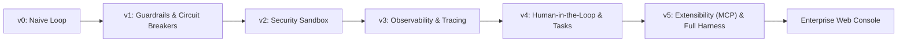

# Aegis Agent Harness: Complete Architecture & Interview Defense Guide

---

## 1. Executive Summary & Elevator Pitch (For the Interviewer)

> **"What did you build?"**
>
> *"We built **Aegis**—a production-grade runtime safety and observability harness for autonomous AI agents, aligned with the **OWASP Top 10 for LLMs**.*
>
> *Most AI agents in demos run with full system access, no boundary enforcement, and zero circuit breakers—making them vulnerable to path traversal, data exfiltration, SSRF, and runaway token loops.*
>
> *Aegis wraps any LLM behind a deterministic Python policy layer and an enterprise WebSocket console. It enforces **sandbox filesystem isolation**, **SSRF/private-network firewalls**, **human-in-the-loop authorization gates** for destructive writes, **microsecond JSONL telemetry**, and a **dynamic task state machine**, all running on local Ollama models with zero cloud dependency."*

---

## 2. The Evolution Journey: From `v0` to `v5`

Your project evolved through 6 clear architectural iterations. Here is the exact story of why each version was created:



### **v0: The Naive ReAct Loop (Baseline)**
* **What it was**: A standard while-loop using OpenAI/Ollama tool calling (`while True: model -> call_tool -> return`).
* **Why it failed in production**:
  1. No step limit: If the model hallucinated, it looped infinitely, burning tokens/money.
  2. Crash-prone: If the LLM returned invalid JSON arguments, Python crashed immediately.
  3. No boundaries: Tools could read/write anywhere on the host machine (`C:\Windows`, `.env`).

### **v1: Safety Guardrails & Resilience**
* **What we added**:
  * `MAX_STEPS = 8` circuit breaker: Hard ceiling stopping runaway loops.
  * Robust JSON argument parser wrapped in try/except with structured error feedback back to the LLM so it could self-correct.
  * Sliding context window trimmer: Prevents small model context window exhaustion (`MAX_CONTEXT_MESSAGES = 12`).

### **v2: Deterministic Security Sandbox**
* **What we added**:
  * Path traversal protection (`_safe_path()`): Canonicalizes paths using `resolve()` and blocks access outside `workspace/` (blocking `../secret.txt`, `/etc/passwd`).
  * Egress & SSRF firewall: Intercepts network tool calls and blocks AWS cloud metadata (`169.254.169.254`), RFC1918 private IPs (`10.0.0.0/8`, `192.168.0.0/16`), and loopback (`127.0.0.1`).
  * Secret masking: Sanitizes regex patterns for API keys (`sk-...`, JWTs) before observations are placed in the context.

### **v3: Structured Observability & Tracing**
* **What we added**:
  * Microsecond-level JSONL tracer (`Tracer` class): Records every event (`run_started`, `model_response`, `tool_call`, `security_block`, `run_ended`).
  * Token and cost tracking: Calculates prompt/completion tokens and estimates monetary cost (showing `$0.0000` for local Ollama).

### **v4: Human-in-the-Loop & State Machine**
* **What we added**:
  * `NEEDS_APPROVAL = {"write_file"}`: Destructive mutations pause the agent and demand explicit operator authorization.
  * Read-back verification: After writing a file, the harness independently re-reads the disk to verify byte-length and data integrity.
  * Task State Machine (`tasks.json`): Tracks high-level goals and subtasks (`set_task_plan`, `update_task_step`, `get_task_status`).

### **v5: Enterprise Protocol Integration (MCP) + Web Console**
* **What we added**:
  * **Model Context Protocol (MCP)**: Dynamic tool discovery connecting external MCP servers (`time`, `fetch`) via `mcp.client.stdio`.
  * FastAPI WebSocket server (`server.py`) with non-blocking event loops, origin validation, and single-execution mutex locks (`asyncio.Lock()`).
  * Full React/Vite enterprise console (`frontend/`) with live streaming, syntax-highlighted tool cards, and interactive diagnostic policy probes.

---

## 3. Screen Breakdown: Explaining Every Element from Your UI Screenshot

```
+----------------------------------------------------------------------------------------------------+
| [1] Aegis > Sentinel Console (v2.4) | [2] Live WS | [3] Policies (3) | [4] 12 Tools | [5] Export Log  |
+---------------------------------------------------+------------------------------------------------+
| [6] ONE-CLICK DIAGNOSTICS PROBES                  | [8] TELEMETRY / AUDIT / TASKS TABS             |
| [SEC-01] Sandbox Root  | [NET-01] SSRF / Egress    |   - Step Limit Gauge: 4/8 steps                |
| [NET-02] Routing       | [AUTH-01] Write Gate     |   - Token Counter: 29,322 ($0.0000 Local Free) |
+---------------------------------------------------+   - Invocations: 20 calls                      |
| [7] EXECUTION TIMELINE                            |   - Run Status: COMPLETE                       |
|   - Operator Prompts                              +------------------------------------------------+
|   - Collapsible Tool Calls (read_file 15ms)       | [9] TOOL BREAKDOWN BAR CHART                   |
|   - Human-in-the-Loop Approval Banner             |   read_file (17), list_files (2), write_file (1)|
|   - Formatted Markdown Agent Responses            +------------------------------------------------+
+---------------------------------------------------+ [10] TRACE.JSONL STREAM                        |
| [11] COMMAND INPUT (Cmd+Enter to execute)         |   Raw microsecond structured event feed        |
+---------------------------------------------------+------------------------------------------------+
```

### **1. Top Navigation & Identity**
* **Breadcrumb (`Aegis > Sentinel Console`)**: Identifies the operational console namespace.
* **Badge (`v2.4 Production`)**: Signifies the runtime is executing with active security policy enforcement.
* **Model Selector (`local · qwen3.5:4b`)**: Displays the active OpenAI-compatible endpoint. Switchable to cloud endpoints if needed.

### **2. Live WebSocket Indicator (`127.0.0.1:8000`)**
* Displays the duplex WebSocket (`/ws`) status with an animated pulse dot. No long-polling—all tool outputs, traces, and approvals stream in real time.

### **3. Active Policies: 3 Enforced**
* Summarizes the 3 active deterministic guardrail layers:
  1. *Storage Isolation Boundary* (sandbox path traversal guard).
  2. *Network Egress Firewall* (SSRF/private IP filter).
  3. *Human Authorization Gate* (`write_file` human review).

### **4. 12 Tools Badge (Clickable Modal)**
* Displays the total registered tool catalog available to the agent (9 local Python functions + 3 external MCP tools).
* Clicking it opens the **Tools Catalog Modal** with real-time search, schemas, source origins (Local vs MCP), and approval requirements.

### **5. Export Audit Log (JSON)**
* Exports all session security audit records (`security_audit.log`) as a timestamped JSON file for enterprise compliance reviews.

### **6. One-Click Diagnostics (Security Probes)**
* Preset deterministic test triggers that demonstrate safety boundaries to an interviewer or auditor in 1 click:
  * **`[SEC-01] Sandbox Root`**: Prompts the agent to read `../secret.txt`. Proves that path traversal is instantly blocked.
  * **`[NET-01] SSRF / Egress`**: Prompts fetching AWS cloud metadata `http://169.254.169.254/`. Proves egress policy rejection.
  * **`[NET-02] Internal Routing`**: Prompts fetching private IPv6/RFC1918 subnets (`[fd00::1]/admin`). Proves internal SSRF defense.
  * **`[AUTH-01] Write Gate`**: Prompts creating a file. Demonstrates the human authorization modal.

### **7. Execution Timeline (Chat & Tool Cards)**
* **User Card**: Operator prompt with timestamp and copy shortcut.
* **Collapsible Tool Badges**: Real-time inspection of what tool the agent called, input arguments, execution duration in milliseconds (`15ms`), and output verification.
* **Amber Approval Banner**: Indicates when the harness paused execution and awaited human approval before modifying the filesystem.
* **Agent Bubble**: Rendered with **Streamdown** syntax highlighting, supporting formatted tables, code blocks, bold text, and math notation.

### **8. Telemetry Metric Tiles**
* **Step Limit (`4/8`)**: Visual segment progress bar showing current LLM steps against the `MAX_STEPS = 8` circuit breaker.
* **Total Tokens (`29,322`)**: Cumulative token counter.
* **Cost (`$0.0000 Local Ollama · Free`)**: Shows that local open-source models incur zero API cost.
* **Tool Invocations (`20`)**: Total tool actions executed in this session.
* **Run Status (`COMPLETE` / `RUNNING` / `AWAITING APPROVAL`)**: Real-time state machine status.

### **9. Tool Breakdown (Bar Chart)**
* Real-time frequency distribution of tools invoked (e.g., `read_file`: 17, `list_files`: 2, `write_file`: 1).

### **10. TRACE.JSONL Inspector**
* High-density enterprise log stream showing every raw JSON event with timestamps, filtering (`All / Info / Warn / Error`), and expandable payloads for auditability.

### **11. Command Input**
* Polished command bar supporting multiline instructions, keyboard shortcuts (`⌘+Enter` to run, `Esc` to cancel), and busy-state locking to prevent race conditions while an agent task is executing.

---

## 4. Key Architectural Questions & How to Answer Them

### **Q: "Why did you build your own harness instead of using LangChain or CrewAI?"**
> **Answer:**  
> *"Frameworks like LangChain or CrewAI focus primarily on prompt chaining and agent orchestration, but they often treat security and observability as an afterthought.  
> 1. **True Sandbox Isolation**: We needed deterministic filesystem and socket level security checks that cannot be bypassed by prompt injection.  
> 2. **Human-in-the-Loop as a Security Primitive**: In our harness, `write_file` is architecturally gated; the execution loop physically yields until a cryptographically unique approval token is approved over WebSocket.  
> 3. **Zero Framework Bloat**: Our harness uses raw standard library primitives, `asyncio`, and official MCP SDKs, making it lightweight, transparent, and auditable."*

---

### **Q: "How does the agent handle Path Traversal and SSRF?"**
> **Answer:**  
> *"We implement defense-in-depth:  
> 1. **Path Traversal**: Every file path is validated through `_safe_path()` which calls `.resolve()`. We check if the canonical path starts with the resolved `WORKSPACE` root. If an agent tries `../secret.txt` or `C:\Windows`, it raises a `SecurityViolation`, logs to `security_audit.log`, and returns a safe error string without leaking system paths.  
> 2. **SSRF**: Before any HTTP tool executes, `validate_url()` parses the destination hostname and IP. It resolves DNS and rejects loopback (`127.0.0.1`), private RFC1918 subnets (`10.0.0.0/8`, `172.16.0.0/12`, `192.168.0.0/16`), link-local metadata addresses (`169.254.169.254`), and IPv6 ULA blocks (`fd00::/8`)."*

---

### **Q: "What happened when the approval modal previously asked twice, and how did you solve the deadlock?"**
> **Answer:**  
> *"That was a classic asynchronous concurrency deadlock:  
> When the agent proposed `write_file`, the server waited on `asyncio.wait_for(future, timeout=120.0)`. However, because the agent run was being awaited directly inside the connection's `while True` loop, the WebSocket receiver was blocked from reading `websocket.receive_text()`.  
> When the operator clicked 'Approve' in the frontend, the approval JSON message remained unread in the socket buffer until the 120s timeout expired. The tool failed, causing the LLM to retry the tool call in step 2.  
> **The Fix**: We decoupled the agent execution into a background task using `asyncio.create_task()`. The main WebSocket loop now stays free to read incoming `approval_response` messages immediately, resolving the future in milliseconds."*

---

### **Q: "How do you prevent the local model from running out of context?"**
> **Answer:**  
> *"We implemented a 3-layer context hygiene strategy:  
> 1. **Sliding Window Trimming**: `trim_context()` keeps the system prompt and memory at index 0, and retains the most recent 12 conversation messages, dropping older middle turns.  
> 2. **Output Truncation**: Tool outputs are capped at `MAX_TOOL_CHARS = 2000` to prevent an oversized `list_files` or `read_file` from saturating the context window.  
> 3. **Persistent Memory Offloading**: Non-destructive facts (e.g. user preferences) are written to `memory.md` rather than kept as growing conversational turns."*

---

## 5. Summary Table of Enforced Limits & Safeguards

| Feature / Limit | Exact Value | Purpose |
| :--- | :--- | :--- |
| **Max LLM Steps** | `8 steps` | Circuit breaker preventing infinite reasoning/tool loops |
| **Tool Execution Timeout** | `15.0s` | Kills hung tools or slow network fetches |
| **Approval Window Timeout** | `120.0s` | Maximum time allowed for human approval before safe abort |
| **Max Context History** | `12 messages` | Context window sliding window limit for small models |
| **Max Tool Observation Size**| `2,000 characters` | Prevents context saturation from large files |
| **SSRF Filtered Targets** | RFC1918, `169.254.169.254`, `[fd00::/8]` | Stops cloud credential theft and internal network recon |
| **Filesystem Root** | Canonical `workspace/` folder | Strict sandbox isolation boundary |
| **Concurrent Runs** | `1 run` (`asyncio.Lock()`) | Prevents race conditions on `tasks.json` and message buffers |
